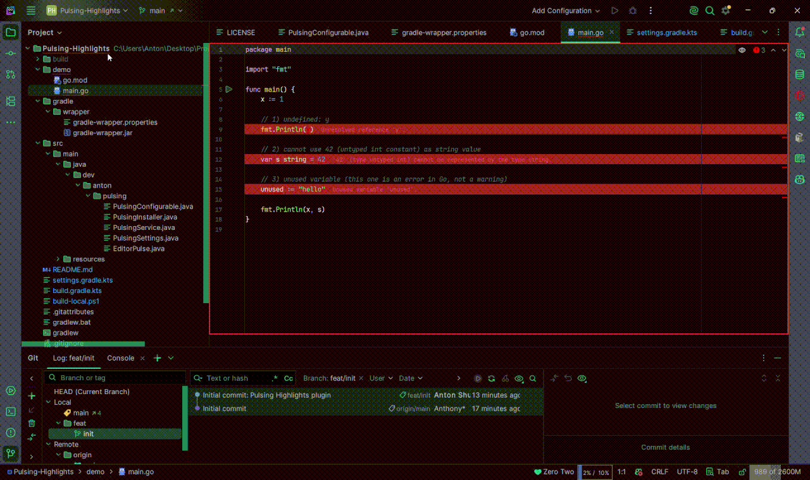
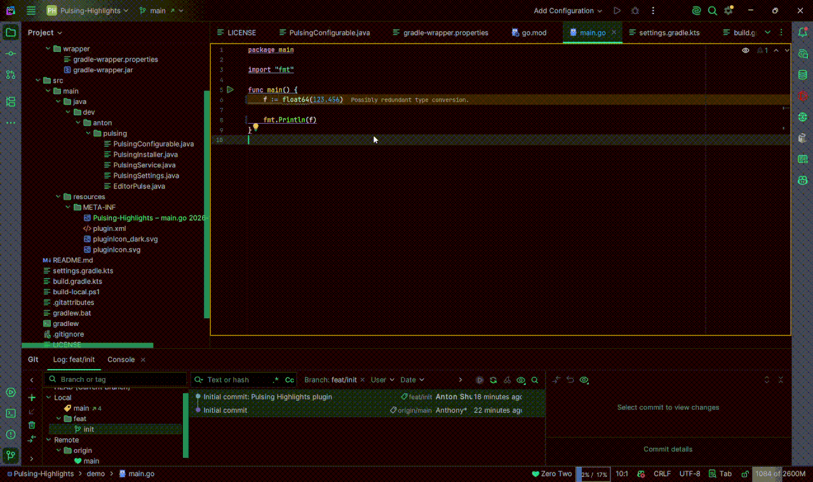

# Pulsing Highlights

Animated problem highlighting for GoLand, IntelliJ IDEA and other IntelliJ-based IDEs.
Errors, warnings and weak warnings are highlighted with a breathing translucent
background instead of a static underline. A newly appeared problem flashes a few
times before settling into the pulse.

Colors depend on severity:

- **Error** — red
- **Warning** — yellow
- **Weak warning** — dark yellow

The plugin can also draw a colored frame around the editor area, based on the worst
problem in the current file.

```
   plain GoLand:        x := 1        ← thin red wave under x
   with the plugin:     █████████████ ← whole line pulses, new problem flashes
```

## Demo

### Error (red)



### Warning (yellow)



Author: **Anton Shubin** — https://github.com/AnthonyFVKT

## Features

- Pulse the **problem range** or the **whole line**.
- Separate colors for errors, warnings and weak warnings.
- Optional colored frame around the editor area (worst problem in the file wins).
- Flash-on-new-problem mode (~1.5 s), then a calm breathing pulse.
- Configurable maximum opacity and pulse period.
- Warnings and weak warnings can be enabled independently.
- Works with any language: the plugin uses editor APIs only and does not depend on
  a specific language plugin.

Settings: **Settings → Editor → Pulsing Highlights**.

## Installation

1. `Settings → Plugins → ⚙ → Install Plugin from Disk…`
2. Select `build/local/pulsing-highlights-0.2.1.zip`.
3. Restart the IDE.

> Plugin id: `dev.anton.pulsing`.

The plugin is built and compile-checked against **GoLand 2026.1** (build 261).
It should work on 2024.1+ (build 241+).

### "Failed to load plugin descriptor"

The ZIP must contain a top-level plugin directory:

```
pulsing-highlights-0.2.1.zip
└── pulsing-highlights/
    └── lib/
        └── pulsing-highlights.jar   (contains META-INF/plugin.xml)
```

`build-local.ps1` produces exactly this layout. As a fallback you can install the
JAR directly: `build/local/pulsing-highlights.jar`.

## Building

### Option 1: no Gradle, no SDK download

Compiles against the JBR and `lib/*.jar` of an already installed IDE.

```powershell
.\build-local.ps1
# or:
.\build-local.ps1 -Ide "C:\Program Files\JetBrains\GoLand 2024.1.4"
```

Output:

- `build/local/pulsing-highlights.jar`
- `build/local/pulsing-highlights-0.2.1.zip`

### Option 2: Gradle

Requires JDK 17+. The Gradle wrapper is included, so a separate Gradle installation is not needed.

```powershell
.\gradlew.bat buildPlugin
# macOS/Linux: ./gradlew buildPlugin
# output: build/distributions/pulsing-highlights-0.2.1.zip
```

## How it works

| File                       | Purpose                                                                                                                             |
|----------------------------|-------------------------------------------------------------------------------------------------------------------------------------|
| `EditorPulse.java`         | 40 ms timer + rescan every 200 ms; keeps a `RangeHighlighter` per problem, updates its background alpha and paints the editor frame |
| `PulsingService.java`      | editor-to-pulse registry, attach/detach, settings changes                                                                           |
| `PulsingInstaller.java`    | `editorFactoryListener` for created/released editors                                                                                |
| `PulsingSettings.java`     | `PersistentStateComponent`, `config/options/pulsing-highlights.xml`                                                                 |
| `PulsingConfigurable.java` | Settings → Editor → Pulsing Highlights                                                                                              |

Key APIs:

- `DaemonCodeAnalyzerEx.processHighlights(document, ...)` — reads problems from the document markup model;
- `HighlightInfo.fromRangeHighlighter(...)` — severity and range of a problem;
- `RangeHighlighterEx.setTextAttributes(...)` — updates an existing highlighter;
- `HighlighterLayer.LAST - 1` — keeps the pulse above other highlights;
- `JScrollPane.setBorder(...)` — editor frame.

## Limitations

- Internal platform classes are used. They have been stable for years, but may change
  in future IDE versions.
- The frame adds a 1–8 px inset inside the editor; it can be disabled.
- When installed without restarting, already open editors may not be attached — restart the IDE.

## License

MIT. Copyright (c) 2026 Anton Shubin — https://github.com/AnthonyFVKT
